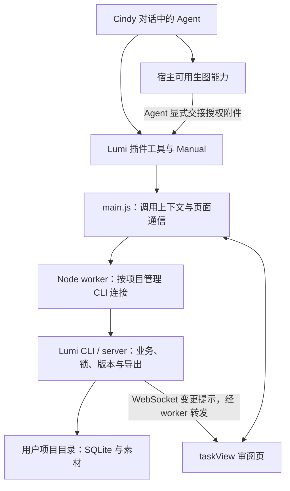

# Lumi Cindy 插件方案

## 目标

让用户在 Cindy 对话中完成 Lumi 绘本创作：从想法、故事和设定，到分页、生图、审阅和导出。AI 创作由当前 Cindy Agent 及其可用媒体能力承担；Lumi 保存作品、管理素材和版本，并保持与桌面版相同的项目格式。

用户不需要在 Lumi 再配置一套模型 API key。是否使用订阅额度、Cindy 媒体服务或用户已配置的供应商，由实际执行路径决定；只有完成相应实测后，才能宣传具体的订阅生图能力。

## 状态与阅读入口

- 本目录是待执行计划，建立于 2026-11-01；本次只编写文档，没有完成插件实现、安装或真实宿主验收。
- 参考 [Codex 总体方案](../codex-plugins/plan.md) 的分步方式，复用其已经存在的 CLI、业务工具、素材导入和审阅组件，不重新实现一套 Lumi 内核。
- 当前宿主文档与源码核对基线：Cindy `0.1.121`，官方 tag `v0.1.121`，commit `727afb1ad6902176e2ec55254154b900c489a998`。接口存在不等于 Lumi 插件链路已验证，证据边界见 [开发依据](references.md)。执行时重新确认真正运行插件的电脑版本。
- 每一步可复制的任务文本集中在 [Goal 提示词](goals.md)。先完成前置步骤，再执行下一步；不把本目录全部内容一次性交给自动续跑。

## 产品形态与支持范围

1. **一个 Cindy 插件**：暂定作者源码目录 `cindy-plugins/lumi/`、插件 id `lumi`、command `lumi`；发布前核查身份冲突。当前只规划目录，不创建产品源码。
2. **对话驱动**：Agent 通过插件工具读写项目，通过插件 Manual 理解创作流程；具体提示词继续来自 Lumi `render_prompt`。
3. **任务审阅页**：以 `taskView` 为主要界面，展示当前任务对应项目的整本、单页、候选与设定。首版选择仍在对话中提交，页内选中只表示预览。
4. **本地项目目录**：保留 `project.sqlite`、`assets/`、`.lumi/`、`STORY.md` 等现有格式。项目不放在卸载即删除的插件私有存储中。
5. **首版执行平台**：macOS 上的 Cindy Desktop。以实际完成验收的 CPU 架构为支持范围；Go 二进制随插件分发，目标是不要求用户安装 Node、Go 或另配 Lumi 桌面版。
6. **手机与远程**：手机控制 Mac 任务不改变项目和执行进程所在电脑。聊天工具是否可用、结果如何交付须实测；桌面 `taskView` 不自动成为手机页面。手机原生审阅页属于独立扩展，须按 Cindy `mobile` 契约实现和验收，首版不宣称支持。SSH 远端目录不能当作插件执行电脑的本地路径。

## 用户流程

用户在 Cindy 为作品选择工作目录并提出创意 → 插件识别或初始化标准 Lumi 项目 → Agent 完成 setup、故事、角色与场景 → 创建章节、页面正文和画面描述 → 查询目标比例与参考图 → Agent 使用可用生图能力 → 插件导入图片并挂载 → 打开任务页审阅 → 用户通过对话修改或选择 → 导出作品。

审阅频率服从用户提示词；缺少会改变作品方向的信息时再提问。默认先确认故事方向，再审阅代表页，批量创作后审阅整本。中断或额度不足时从 SQLite 事实状态续做，不靠聊天中的完成描述推断作品已保存。

## 架构与分工

图中 WebSocket 提示经过 Node → main.js → 页面转发，页面本身不直连本地 server。收到提示后，TanStack Query 失效并经桥接请求 REST 重读 SQLite；首次 join、重新 join 和窗口聚焦均校准。

| 层 | 职责 | 复用边界 |
| --- | --- | --- |
| Cindy Agent | 理解需求、创作文本、发起生图、决定工具调用 | 不在插件后台重建模型 pipeline；首版串行即可，多 Agent 非前提 |
| 插件工具与 Manual | 发现能力、业务参数、流程和恢复指引 | 超过 16 个顶层工具时使用 `list_tools` / `call_tool` 两段式目录 |
| 浏览器逻辑页 `main.js` | 接收可信 `session_context`、保留 `callId`、交接媒体、路由页面 | 没有 Node、直接磁盘或任意网络能力 |
| 随包 Node worker | 启动本地 CLI 代理、项目隔离、REST/WS 转发、受控暂存 | 可信原生代码；不把浏览器沙箱当作它的权限保障 |
| Lumi CLI/server | 现有创作工具、项目锁、revision、素材和导出 | 优先复用 `cmd/lumi`、`internal/textmcp`、`internal/project`、`internal/production` |
| 审阅 UI | 展示正文、预览和候选、连接状态与文本兜底 | 复用 `web/mcp-app/` 的展示与状态逻辑，替换 MCP Apps 桥接 |

### 项目与会话

- 一份 Lumi 项目对应一个标准项目根目录；一个项目可以有多个 Cindy 任务。
- 同一插件的 Node worker 会跨任务复用。内部连接按规范化项目根、environment、data-dir 等实际实例身份分组；禁止 `process.chdir()` 或全局可变的“当前项目”。
- 工具入口由 Host 注入的 `session_context` 解析绑定，不接受模型填写任意 `root_path` 或伪造会话上下文。内部路径只用于本机桥接，业务资源标识使用公开 UUIDv7。
- UI 的 `session` 参数用于路由，不能作为目录授权凭据。任务页只访问经工具入口建立并复核的绑定；重启后重新确认，找不到绑定时显示未连接。
- 同一项目的并发写入继续使用 `expected_revision`。CLI 与桌面版占用冲突继续返回 `project_locked`；卸载或关闭某个任务不停止其他任务使用的共享 CLI 实例。

### 模型与媒体

- 首版通用路径：插件提供目标、提示词与模型偏好 → 当前 Agent 调用 Cindy Core `media` → Agent 用 `ghost_call.attachments` 交接 → 插件把授权图片导入 Lumi。
- 在支持引擎原生生图的会话中，另验证原生产物是否能走同样的附件授权链。不能仅因当前 Agent 能生图，就认定插件能读取产物或使用订阅额度。
- 图片最终复制进 Lumi Asset Store；仅保存 Cindy 媒体引用不能满足离线、迁移及桌面互通要求。
- 保留 `keep/crop/pad` 和原图历史，不强制宿主返回精确像素。生图后立即导入，避免临时产物过期。

### 安装与权限

- 新 manifest 使用 `schemaVersion: 3`。基础能力预计为 `node`、`sessionContext`、`taskView`、工具和 Manual；媒体目录/寄存等按实际使用声明。首次实现时按开发 Skill 对齐尚未确定的产品选择。
- 默认按需启动。持续 WS 监听所需 worker 生命周期由 Step 4.5 实测决定，只有确需常驻时才声明；聊天 hooks 是独立的可选能力，不混入首版基础包权限。
- 随包 Go CLI 是主方案：制作阶段打包依赖、可执行文件与静态 UI。禁止首次启动时 `npm install`、`npx` 或下载可执行代码。包体/架构不能满足时，先记录原因并调整分发设计，不能暗中改为在线安装器。
- Forge 打包、安装、公开发布是不同动作。执行某一步开发或打包不自动授权安装或发布；已有明确授权时沿用，不重复询问。真实宿主验证需要安装时，先准备可审阅的包，再走宿主正常安装流程。

## 分步计划

| 步骤 | 用户得到的结果 | 前置 | 文档 |
| --- | --- | --- | --- |
| 0 | 有证据的宿主能力、安装与媒体链路结论 | 无 | [关键行为调研](step0-spike.md) |
| 1 | Cindy 工具能安全连接本机 Lumi CLI | 0 的运行时门槛 | [插件运行时与 CLI](step1-runtime-cli.md) |
| 2 | 当前任务目录成为可与桌面互通的 Lumi 项目 | 1 | [项目绑定与初始化](step2-project-binding.md) |
| 3 | 在 Cindy 对话中完成整本文本并导出 | 2 | [文本创作工具](step3-authoring-tools.md) |
| 4 | 宿主图片进入项目并挂到正确页面 | 3、0 的媒体门槛 | [宿主生图导入](step4-image-import.md) |
| 4.5 | 真实 Cindy 中验证任务页、图片和实时桥接 | 4 | [任务页宿主验收](step4.5-task-view-acceptance.md) |
| 5 | 可用的四类绘本审阅界面 | 4.5 的 UI 门槛 | [任务审阅页](step5-task-view.md) |
| 6 | 可安装的 `.cindy` 包、完整 Manual 和端到端验收 | 1–5 | [插件打包与安装](step6-plugin-install.md) |
| 7（可选） | 明确范围的 Cindy 创作记录归档 | 6、0 的记录能力门槛 | [会话记录归档](step7-session-archive.md) |

执行顺序：`0 → 1 → 2 → 3 → 4 → 4.5 → 5 → 6`，之后单独决定是否执行 7。探针暴露问题时修订受影响的后续计划；不把“未验证”转换成“已支持”。

## 共同约束与最终验收

- 遵守根 `AGENTS.md`：业务 API 资源化，JSON 使用 `success/data/error` 与 `snake_case`；内部 bigint 自增 ID 不外泄；实时 payload 只含公开 UUIDv7。
- Cindy 自身 API 的 `ok`、`sessionId`、`callId` 等按宿主契约原样使用，只在 Lumi 业务边界转换；不能为统一格式擅改宿主字段或把宿主不透明标识冒充 Lumi UUID。
- 不修改旧 MCP `internal/mcpserver` 与旧插件；现有 Codex 新链路也须继续可用。共用代码确需调整时增加有意义的兼容验证。
- 不让 Agent/插件直接改 SQLite 或素材索引，不复制模型提示词，不把 `AGENTS.md` 的行为指引描述为跨引擎强制沙箱。
- 不使用定时 HTTP/MCP 查询刷新业务状态，不关闭 CSP、来源校验或桌面鉴权。
- 不在本地运行 Cargo/Rust。仅运行与改动有关的 Go、前端、Node 检查；纯计划文档变更只检查文档。
- 最终主线验收：真实 Cindy 中，从空目录完成至少 3 页绘本、至少一张真实宿主生图及一次修改/候选选择，导出 PDF/ZIP；中断恢复、双任务隔离、重复写/版本冲突、CLI 与桌面项目锁切换均有证据。
- 分别报告自动化、真实宿主、真实媒体、发布状态；mock 通过不等于宿主通过，打包成功不等于安装或市场上架。
