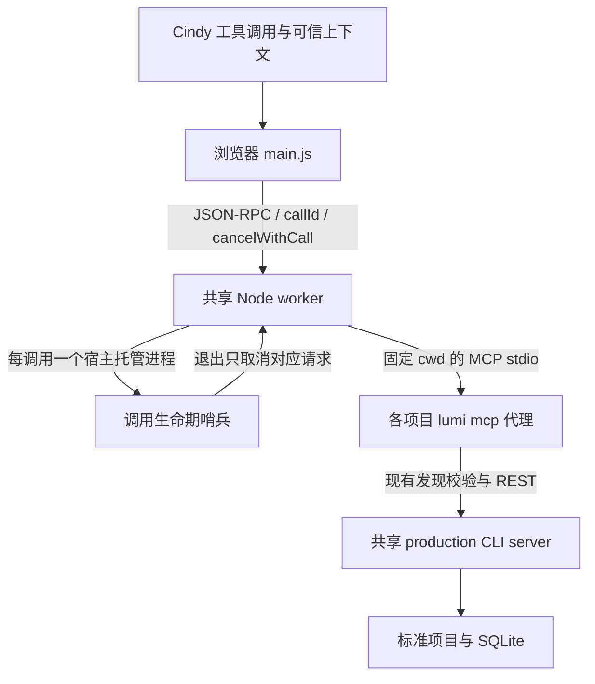

# Step 1 · Cindy 本地运行时

2026-11-01。作者源码在 [cindy-plugins/lumi](../../../cindy-plugins/lumi)，当前交付为 macOS arm64 开发包。只提供 `runtime_status`、`project_overview`、`runtime_release`；没有初始化、写作、媒体、taskView 或消息归档功能。未安装、未发布，不自动进入 Step 2。

## 宿主依据

本机 Cindy `0.1.121`，构建 `sourceCommit=0a7d5a419f5cd3e0fbebc9642dde8388376a68aa`、`builtAt=2026-10-30T01:16:08.865+08:00`。对应公开 ref 查询仍返回 404；官方 tag 指向 `727afb1ad6902176e2ec55254154b900c489a998`，不是该构建源码。

实现依据是当前宿主随包 `cindy-plugin-creator` 的 Node、调用上下文、sessionContext、沙箱与打包契约，以及 Step 0 已取得的实测结果。当前导出的 Skill 与应用内 Skill SHA256 相同。额外只读检查了该应用包的 `.vite/build/nodeRuntimeWorkerProcess.js`：其 `spawnEntry` 捕获当前 RPC 作用域，`request-settled` 使作用域失效；这属于构建产物阅读，不是精确源码或真实取消验收。

manifest 的 `minCindyVersion=0.1.121` 由本次 Forge scaffold 自动写入，仅记录本机开发包字段。**最低正式兼容版本仍未验证**，发布前须取得首个正式版本证据并校准；不能用不匹配的 tag、此字段或打包成功替代证明。

## 消息链与边界

- `main.js` 是浏览器代码；不使用 Node、任意网络或文件 API。只从 Host 注入的 `msg.args.session_context` 取四个字段，原样透传当次 `msg.callId`；不落盘、不交页面。工具 schema 没有任意路径、可执行文件、环境变量或 SQL 参数，额外字段被拒绝。
- worker 自己验证上下文形状、本地状态、只读状态、绝对目录与真实路径。可信性来自 Host 注入，Node 的形状校验不是防伪签名或操作系统沙箱。真实 Host 覆盖模型伪造值只有 Step 0 证据，本产品尚未安装复测。
- 随包 CLI 通过绝对路径与参数数组 `spawn`，`shell:false`。每个 MCP 代理创建时固定 `cwd`；worker 不调用 `process.chdir()`。环境只保留明确的 HOME、系统 PATH、TMPDIR/LANG，不继承 `LUMI_DATA_DIR`、桌面 token、代理设置或开发环境提示。
- 正式入口固定 `environment=production`、数据目录为本机 HOME 下的 `.lumi`，与现有 CLI 默认值一致。测试通过内部构造器指定隔离目录；这不是公开工具参数。worker 校验随包 CLI 执行位、平台和 SHA256。
- Cindy → worker 使用 `json-rpc-stdio`，不是 `mcp-stdio`。worker 对 Go 子进程执行 `initialize → notifications/initialized → tools/list`，校验 `lumi-text/1.0.0` 与协议能力；Host 不重复初始化这条子连接。MCP 反向请求返回 `-32601`。
- 实际业务复用既有 `lumi mcp → CLI discovery/identity → /api/v1/creation-requests → textmcp.Service`。插件不读取 SQLite、素材索引或发现文件，也不改桌面鉴权、Origin 或 CSP。

## 本步工具与只读限制

| 工具 | 行为 | 只读任务 |
| --- | --- | --- |
| `runtime_status` | MCP 初始化、tools/list、ping；可写任务中通过 CLI status 校验已有服务；只返回必要版本、平台及运行状态 | 允许；仅检查 MCP，不运行可能创建 data-dir 锁的 status；server_running=null |
| `project_overview` | 仅转发现有 project_overview；可启动共享 server、打开已有项目 | 拒绝；现有 CLI 打开项目可能运行迁移、写锁/WAL 与运行状态 |
| `runtime_release` | 先撤销当前任务绑定，再取消并等待该任务在途请求，释放它的代理引用 | 允许；不改作品、不停止 server |

远端、未知位置、缺失上下文或非法目录均失败。SSH 路径不映射成本机同名路径。概况调用不初始化项目、不生成 Codex guidance；未初始化项目返回现有业务错误。诊断不返回目录、PID、endpoint、nonce、系统环境或凭证。

只读诊断跳过 CLI status，是因为任务目录可能包含 `.lumi` 数据目录（例如工作目录就是 HOME）；不能把 status 的锁文件副作用误称为在任何目录都只读。`server_observation=not_checked_read_only` 明确表示此时没有验证共享服务状态。

## 三种生命周期与归属

| 资源 | 身份与引用 | 释放策略 |
| --- | --- | --- |
| Host Node worker | 每插件一个，`on-demand`、空闲 120 秒 | 不通过通知或业务读取保活；逻辑页也为 on-demand |
| 项目 MCP 代理 | 规范化根目录、目录 dev/ino、environment、真实 data-dir、CLI SHA256；任务引用与在途数分别记录 | 任务释放只减自身引用；零引用且无请求立即关闭；无在途请求空闲 30 秒关闭；绑定空闲 60 秒失效 |
| CLI server | CLI 自身的 endpoint/PID/environment/nonce，经 `lumi status` 在线复核 | 一律视为外部可共享，不自动 stop；沿用现有约 15 秒的项目空闲释放机制，server 可继续存活 |

server 记录区分 `observed_existing_shared` 与 `first_observed_shared`。从“之前未运行、之后运行”只能推断本次首次观测到实例，不能证明由 Cindy 独占创建；其他客户端可能在同一时刻启动或随后加入。代理引用为零不能证明 server 无 Codex/REST/桌面用户，因此生产适配层没有 stop、DELETE 实例或按 PID 清理 server 的路径。

已有实例不可用、版本不兼容或发现信息过期时，继续使用 CLI 自身的在线身份、启动锁与单实例逻辑；不删除未知锁、不杀未知 PID、不把停掉其他使用者的服务当升级方案。涉及服务的可写上下文调用会检查实例，不使用 HTTP 定时业务轮询；只读诊断和释放不接触服务。MCP 代理是无缓存 endpoint 的 relay，发现 server 代次变化时清除旧身份，下一次工具请求重新发现；调用跨代次时返回 `instance_changed`，不自动重放。

绑定只在内存中保存。每次调用重做 realpath/dev/ino 检查；返回概况时复核公开项目 UUIDv7。相同任务的路径或项目身份变化先撤销旧绑定并返回 `binding_changed`；后续显式调用才能建立新绑定。worker 重启不从磁盘恢复任务、路径权限、callId 或页面资格，已有 server 被重新发现后视为共享实例。

释放先撤销绑定再等待在途结束，晚到的初始化或返回不能恢复旧绑定。当前没有页面通道，focus、node-status、订阅或后台事件都不会启动业务读取。未来 taskView 必须重新设计页面授权与显式重绑定，不能用 session 路由值唤醒已撤销的连接。

## 取消、崩溃与回收

所有工具请求携带真实 `callId` 与 `cancelWithCall:true`。共享 Go 代理不绑定某一次 Host 调用。worker 在请求回调的同步部分捕获 `spawnEntry('node/request-lifetime.cjs')`，创建仅属于该次调用的小进程；Host 取消或结束调用时回收它。哨兵退出触发对应 AbortController，再发送具体 MCP requestId 的 `notifications/cancelled`。同项目的其他请求仍使用原代理。

缺少 Host `cancelWithCall` 注入或 `spawnEntry` 时返回 `cancellation_unavailable`，不会静默降级为不可取消的后台请求。小进程本身不接触项目、网络、CLI 或凭证；不使用 `process.execPath` 启动产品子 Node。该策略的 Node 自动化已验证，**真实 Cindy 取消与四个并发 childSpawn 的时序仍待安装后验证**。

正常释放关闭自己创建的代理 stdin，必要时 TERM/KILL 的对象是当前 ChildProcess 句柄；无持久化 PID，不会误杀重用 PID。异常 worker SIGKILL 时依靠私有管道 EOF 结束 Go MCP，已在本机真实 Go CLI 上验证，不依赖退出回调。server 是 detached 的独立共享资源，保留它是明确策略，不声称卸载、更新或崩溃必定让它退出。

CLI 子进程崩溃使该连接的在途请求失败并移除连接；下一次调用可重建。一个项目的协议损坏可能使该项目共用代理全部失败，这是传输失效的范围；单请求取消不升级为代理整体终止。没有本步暂存文件需要回收。

## 限制、错误与恢复

| 项目 | 实际限制 |
| --- | --- |
| Host Node 在途上限 | 32；本插件主动收紧为 4，对应 Host childSpawn 的 4 个子进程上限 |
| worker params | 256 KiB；仅接收固定 context 对象 |
| MCP params | 240 KiB，给 JSON-RPC 信封留余量 |
| stdout 一行 | 1 MiB 减 1 KiB；输入/输出逐行限长，超限返回完整错误或终止受损连接，不截断 JSON |
| MCP 在途 | 每代理最多 32；主入口仍受全插件 4 调用限制 |
| 连接与绑定 | 至多 16 个项目连接、128 个任务绑定，有界空闲回收 |
| 时间 | Host RPC 60 秒；worker 调用哨兵 50 秒；MCP 请求与 CLI 业务转发各 25 秒；status 5 秒 |

stdout 只传协议，CLI stderr 被消费但不回传路径或环境。结果保留 Lumi 的 `success/data/error` 信封，不能把 Host `ok:true` 当业务成功。Host `ok:false`、无效协议、崩溃、超时、超限均转成 `success:false`。MCP 原始错误文本不直接泄露给 Agent。

`protocol_error`、`cli_exited`、`cli_incompatible`、`instance_unavailable` 等保留为可行动失败；业务错误如 `project_locked` 原样保留。不自动重试业务请求。协议层为未来写调用预留 `mutation:true`：取消或超时返回 `result_unknown` 并要求重读，不自动重放；本步尚无写工具，也不宣称验证了实际业务写入取消的原子性。

## 构建和验收

构建与复现入口见 [作者 README](../../../cindy-plugins/README.md)。包内静态 Node 源码零第三方依赖，Go CLI 制作时编译；运行时不需要外装 Node/Go、不下载代码、不运行 npm/npx。

未改 `cmd/`、`internal/`、`web/` 或既有 Codex 插件；未运行 Cargo/Rust。自动化、实际 Go CLI、Forge 打包和真实 Cindy 宿主状态分别记录于 [Step 1 验收](acceptance/step1-runtime.md)。
