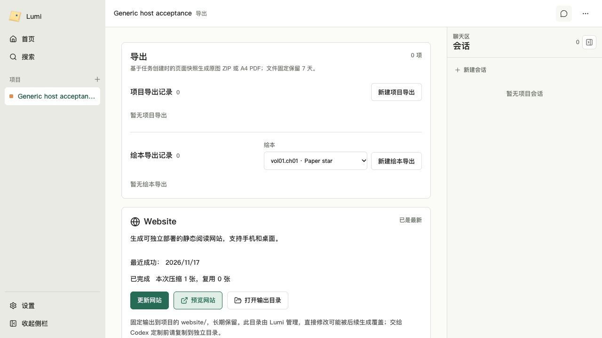
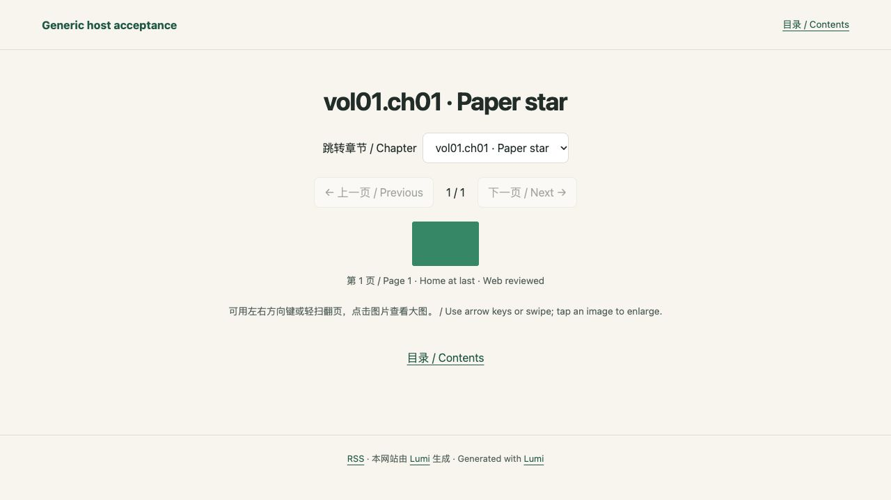

# 通用 Agent 接入验收

日期：2026-11-17。平台：macOS arm64。接入示例与迁移步骤见 [通用接入包](../agent-integration/README.md)。

## 改动与兼容范围

- 新入口为 `lumi mcp --host generic`，保持 stdio 与启动 cwd 绑定。原 Claude 的 `generate_page_image`、`web_url` 迁入通用模式；仅发布 20 个创作工具，不发布 App 工具、审阅窗口资源或 `review_*`。
- 通用请求要求创作协议 v10，旧后台收到请求前返回升级提示，不擅自停止其他宿主共享的后台。Codex、Cindy 和省略 host 的工具清单、原协议门槛、图片导入与导出行为保留。
- `plugin-skills/` 生成 `agent-integration/skills/create-picture-book/`。三个通用宿主只配置各自的 Skill 位置与 MCP 格式，不维护额外插件。生成后的 Codex Skill 与迁移前逐字一致；同时补齐了原共享源与已发布 Codex Skill 的差异。
- 移除 `claude-plugins/`、`make claude-dev*`、专属安装脚本与 hook。新指引使用宿主中立的 `AGENTS.md`；不新建 `CLAUDE.md`，已有文件及宿主配置保留。
- Cindy 的 runtime、Manual、业务 schema 快照未改；审阅共享差异后更新 source pins 和构建漂移测试的通用产物路径。桌面 Web 源码、样式与路由未改。

## 第一层：通用流程

[跨进程集成测试](../cmd/lumi/generic_test.go)实际执行 stdio → CLI 后台 → 持久生图任务 → HTTP 图片服务 → Asset Store → 当前页面 → 审阅记录 → Markdown/ZIP/PDF。只有远端图片服务使用本机模拟实现；它核对默认图片模型、请求提示词与图片凭据。应用配置、项目数据库、任务执行和图片挂载均为真实实现。

覆盖未初始化目录、项目创建与规格定稿、章节和页面写回、显式无参考页面生图、重连后同幂等键仅生成一次、MCP 图片读取、当前图片核对记录、准确页面 Web URL、三个格式导出，以及不同 cwd 不能读到该项目。测试使用内存钥匙串和合成图片，不使用用户项目、系统钥匙串或真实服务商额度。设定引用、过期证据、revision 冲突、任务失败与恢复由现有 `internal/textmcp`、`internal/jobqueue` 回归覆盖。

浏览器实际打开同一临时作品的 Lumi Web，检查项目主页、绘本页面、当前图片和编辑控件。修改标题并保存后，通过 MCP 重新读取确认一致；无 Provider 时点击「生成新稿」正确显示配置错误。实际点击 Website「生成网站」，观察任务进度经实时提示更新为「已完成／已是最新」，打开预览并进入阅读页，确认图片、页标题、章节和导航正常。

Web 图像为合成夹具。成功的生图链路在上述 Go 集成中验证；浏览器没有调用真实图片服务。[Web 回执](evidence/generic-agent-20261117/web-receipt.json)记录了保存后重读结果。

## 第二层：真实宿主最小接入

三个宿主程序均真实启动，使用隔离配置、本机确定性模型夹具及同一份 Skill。模型夹具只要求加载 Skill、发现／调用工具并结束；MCP 服务、宿主的 Skill 加载和工具执行没有替身。三个宿主均从同一临时绘本目录启动，实际工具结果都返回项目 `Generic host acceptance`、UUID `01a1e72d-499b-746c-a074-827e28d8fac5`。[回执](evidence/generic-agent-20261117/host-receipts.json)保留最终二进制和 Skill 摘要、版本、工具序列与实际项目字段，不保存凭据或完整模型请求。

| 宿主 | 实测版本 | Skill 和 MCP 验证 |
|---|---|---|
| OpenCode | 2.2.0 | `.opencode/skills` 链接共享 Skill，`skill({id:"create-picture-book"})` 加载；默认 Code Mode 经 `execute` 调用 `tools.lumi.project_overview({})`。独立临时服务先完成异步 MCP 连接，再开始验收回合。 |
| pi | 1.5.2 | `.pi/skills` 链接同一目录，原生 Skill 发现后由 `read` 加载；`.pi/mcp.json` 使用原生 MCP、direct exposure，调用 `mcp__lumi__project_overview`。pi 安装在临时目录，未修改全局版本。 |
| Claude Code | 2.1.322 | `.claude/skills` 链接同一目录，原生 `Skill` 成功加载；`.mcp.json` 注册相同服务，经 `ToolSearch` 发现并调用 `mcp__lumi__project_overview`。隔离配置保留项目 Skill 来源并禁用 hook。 |

测试显式设置与实际 cwd 一致的 `PWD`，不使用用户默认模型或共享 OpenCode 服务。宿主只验证上述最小接入，不将模拟模型视为真实模型创作质量验收。三个宿主不分别重跑整本创作链路。

## 自动回归

| 检查 | 结果 |
|---|---|
| `go test ./...` | 全部通过（43 个有测试的包）；包含 stdio、版本兼容、项目隔离、生图、WebSocket、审阅与导出。 |
| 最后改动后 `go test ./cmd/lumi ./internal/textmcp` | 通过。 |
| `pnpm --dir web test` | 479 项通过。 |
| `pnpm --dir web run build` | 通过，保留现有大 chunk 提示。 |
| `node --test cindy-plugins/tests/*.test.cjs` | 110 项通过，独立覆盖真实 CLI、绑定、附件／设定拆分、页面图片导入、审阅、恢复、导出和 workspace 边界。 |
| Codex 构建／开发包／共享 Skill，以及更新后的 Cindy 创作 gate 测试 | 16 项通过。 |
| `node scripts/build-skills.mjs --check` | 通过；Codex 产物无差异。 |
| `node cindy-plugins/scripts/check-authoring.mjs` | 10 条工作流规则与 source pins 通过。 |
| Skill Creator `quick_validate.py` | 通用 Skill 通过。 |
| `python3 scripts/test-codex-cli.py --binary <最终嵌入 Web 的 lumi>` | 真实二进制 singleton、stdio、Unicode 目录、图片导入、PDF/ZIP、Codex＋generic 网站、Web 预览、停止与重启通过。 |
| `git diff --check` | 通过。 |

Go 测试缓存设置在临时目录；需要监听 loopback 的检查在允许本机网络的执行环境运行。没有运行 Cargo、Rust 编译／检查／测试。

## 未实测项

- 真实付费图片服务的联网、计费和生成画质；三个宿主使用真实模型完成整本创作。
- 本轮没有在 Codex App 或 Cindy 原生界面重新安装插件、执行宿主原生生图／ghost_call 或人工图像审阅。两者的独立协议、适配层、打包和行为回归如上，不能替代这些原生界面验收。
- Windows／Linux 宿主、桌面原生打包、签名、发布及 CI。本轮未部署网站、改动用户宿主配置或卸载用户已安装的旧 Claude 插件。
